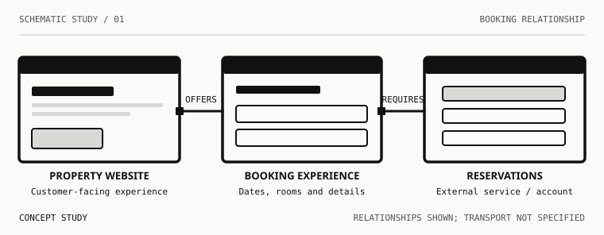
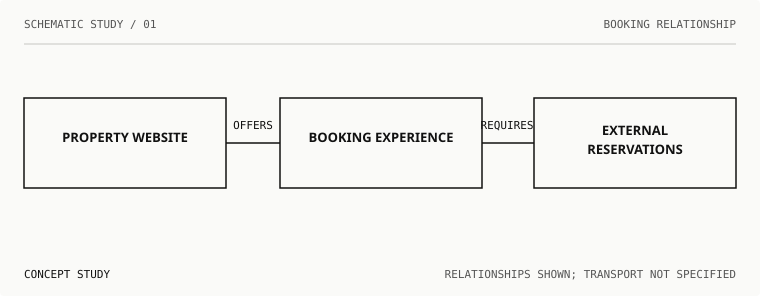
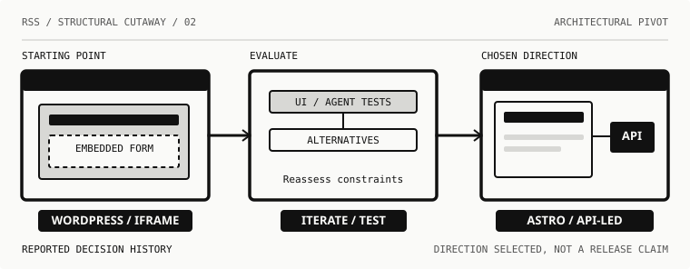
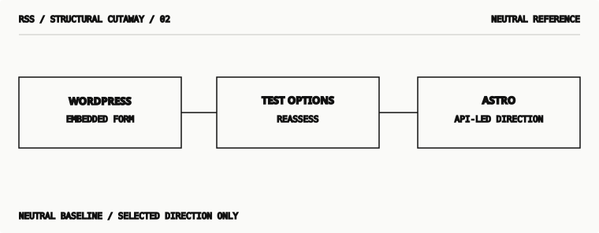
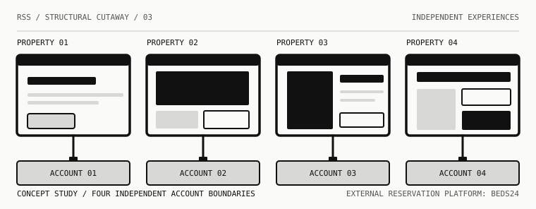
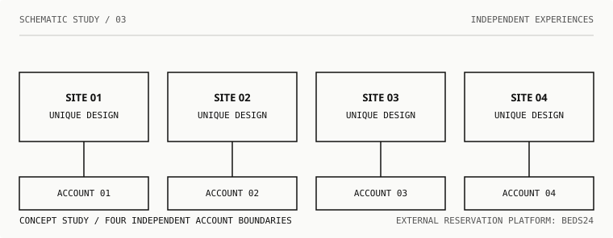
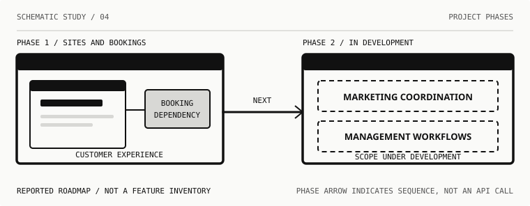
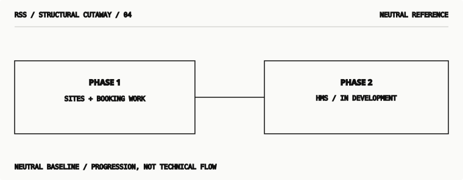

# Schematic grammar pilot: structural cutaways vs. neutral diagram baselines

**Status:** v0.2 visual evaluation proposal. No production claim, standardization, API release, or downstream site deployment. The public 0.1.0 package and its exports stay unchanged.

The four subjects are grounded in an owner-reported hospitality website/booking modernization project, abstracted into anonymous examples. The diagrams are **not screenshots, verified technical topology, or delivery evidence**. Refer to [manifest.json](manifest.json) for audience, question, relation types and long descriptions. Read the [proposed grammar](../../docs/schematic-grammar-v0.2-proposal.md) and [validation plan](../../docs/research/validation-matrix-2026-10-27.md) before using an image.

The **paired exploratory comparison** asks whether the stronger structural cutaway helps comprehension more than simple labelled rectangles. Both treatments aim to preserve the same core facts, subject headings, connection direction where applicable, and implementation-status caveats. The baseline is a deliberately plain communication reference, not an alternative brand identity. **This is not yet an isolated-variable experiment:** geometry, visual detail, content density and silhouette differ between treatments, so preferences cannot be attributed to any single stylistic feature. Future comprehension trials should include a typography/label-matched intermediate condition and counterbalanced presentation order.

| Structural cutaway C | Neutral boxes-and-lines baseline |
| --- | --- |
| **Booking relationship** —  |  |
| **Architectural pivot** —  |  |
| **Four independent experiences** —  |  |
| **HMS phase-two expansion** —  |  |

## Individual questions and intended takeaways

### 1. Booking relationship

**Question:** How is a property's booking journey related to an external reservations service?

**Takeaway:** A property's website, booking experience, and external reservation account have distinct responsibilities.

**Status:** Reported by project owner; connection type and shipment status unverified.

**Long description:** A simplified property website is shown at left, a separate booking experience in the center, and an external reservations platform at right. Lines connect the three to communicate responsibilities and dependency. The picture does not establish whether a direct API, iframe, or other route currently transports booking data.

### 2. Architectural pivot

**Question:** Why was the original WordPress and iframe approach reconsidered?

**Takeaway:** The project tested the old approach and changed direction toward Astro sites and API-led booking.

**Status:** Project owner described repeated modernization and iframe/agent tests followed by the Astro/API direction; do not infer deployment.

**Long description:** Three stages appear from left to right: the original WordPress site with an embedded booking frame, a central evaluation stage, and a new Astro web interface with a separate API-led integration element. Arrows show a chronological decision rather than data flow. The last frame denotes the chosen architectural direction, not its completed delivery.

### 3. Four independent experiences

**Question:** Why do four properties have distinct websites even though they all need reservations?

**Takeaway:** Each property can express a distinct visual identity while maintaining its own booking dependency.

**Status:** The project owner reports four independent site designs with no shared design components and separate Beds24 property accounts; no screenshots are reproduced.

**Long description:** Four separate website frames are arranged horizontally. Their interior silhouettes are deliberately different: a conventional content page, an image-led landing page, a strong two-column page, and an asymmetrical set of panels. A straight line descends from each website to a separate numbered reservation account. No central shared reservation account is implied, and the illustrations do not reproduce real designs or confirm an API route.

### 4. HMS phase-two expansion

**Question:** How does the future HMS effort change the scope of the original project?

**Takeaway:** The first phase addresses property websites and reservations; HMS is a second phase expanding toward management and marketing coordination.

**Status:** Project owner described HMS as a second phase; specific functionality is still being developed.

**Long description:** A left panel titled Phase 1 shows a website and separate booking dependency. A single arrow, labelled Next, leads to a right panel titled Phase 2 / In Development, containing proposed marketing coordination and management workflow areas. Dashed boundaries and explicit labels mark proposed scope, not deployed features. The arrow indicates project sequence, not a software API.

## Rendering and review requirements

These are 760px-wide **medium/detail illustrations** and should be inspected at a size where 11–13px in-SVG labels are readable. Do **not** simply scale this same SVG to 96px and call it a small emblem. For a narrow mobile layout, pair an appropriately simplified derived illustration with nearby textual explanation, or offer an independently scrollable detailed image and equivalent text. Test actual sizes before release.

Use the evaluation matrix: five-second gist, whether connectors are interpreted as confirmed live data flows, historical/planned status, comprehension compared with equivalent short prose, safe text equivalents, shape consistency and project-claim accuracy. None of these checks has been performed with readers yet.

The four diagrams are deliberately different compositions; shared visual cues are bolder black frames, distinctive interface cutaways, straight connections, square attachment marks, warm paper, stepped-gray fills, simple corners, monotone labels, negative space and the inherited site design. No renderer, component API, or reusable SVG symbol definitions have been standardized.
